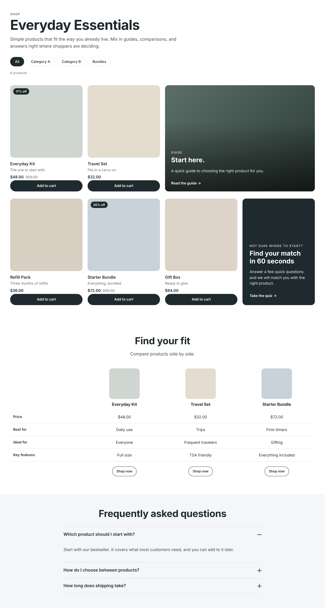
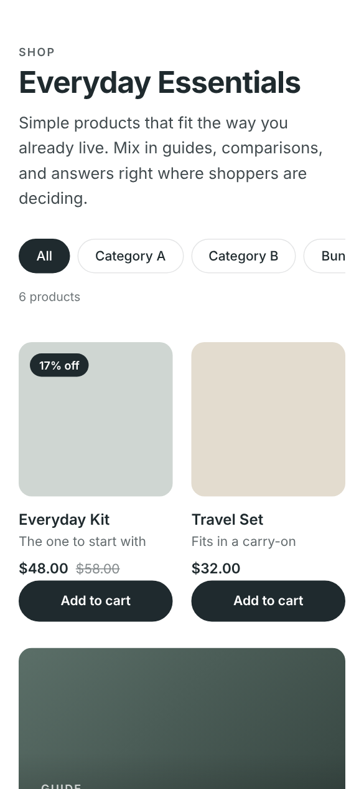

# Collection Content Template for Shopify

A Shopify collection page template that puts education and decision support next to the products, instead of a plain product grid.

## The problem
Most collection pages are a wall of product cards. Shoppers who aren't sure which product fits them have to leave the page to find answers in PDPs, blog posts, or support. For a brand that sells a small routine-based catalog, that's where conversion leaks.

## What I built
A drop-in collection template made of six editable sections. Merchandisers control everything in the theme editor without touching code.

| Section | What it does |
|---|---|
| **Collection hero** | Title, intro copy, filter pills to related collections, product count. Falls back to the collection's own title and description. |
| **Product grid** | Product cards with sale badges, hover images, quick add, and pagination. Editorial cards can be placed between products at any position, 1 or 2 columns wide, in 3 styles. |
| **Image trio** | Three lifestyle images with a brand message. |
| **Comparison table** | Pick up to 4 products; row labels and values are fully editable. Prices pull live from Shopify. Scrolls horizontally on mobile. |
| **Content cards** | Guides or articles. Add cards manually, or point it at a blog to pull the latest posts automatically. |
| **FAQ** | Accessible accordion that also outputs FAQPage structured data for search. |

## Decisions worth noting
- **Content tiles don't displace products.** Grid templates that inject tiles into a fixed number of slots quietly drop products off each page. This grid sizes itself to products plus tiles, so every product still renders.
- **Editor-first.** Every string, image, color, and position is a setting. Blank overrides fall back to collection data, so one template works across many collections.
- **Scoped styles.** All CSS is namespaced (`cc-`) so it can't collide with an existing theme.
- **Performance.** Responsive images with `srcset`, lazy loading below the fold, no JavaScript dependencies.
- **Accessibility.** Native `
` accordion, real table markup with row and column headers, focusable scroll regions, reduced-motion support.
- **Validated** with Shopify's Theme Check (0 issues).

## Install
1. Duplicate your live theme, then open **Edit code** on the copy.
2. Add the files in `assets/`, `snippets/`, `sections/`, and `templates/`.
3. Assign the **content** template to a collection, then customize it in the theme editor.

Product taglines read from an optional product metafield `custom.tagline`.

`docs/demo.html` is a static mockup used for the screenshots, with placeholder products.
